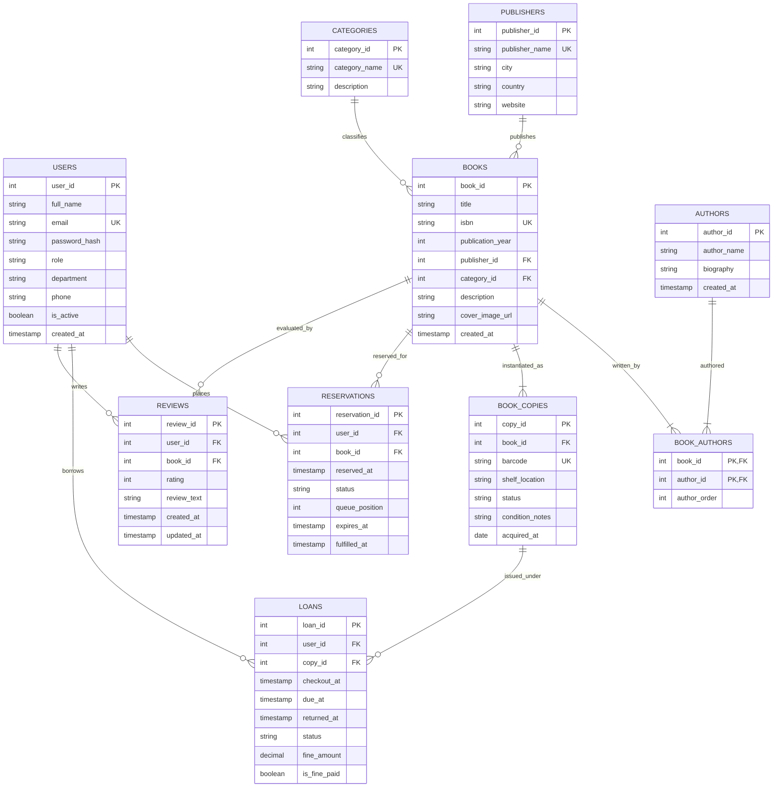

# Entity-Relationship (ER) Model
## Digital Library Book Reservation and Recommendation System

**Course:** Database Management Systems (DBMS)  
**Alignment:** DBMS Module 3 (Database Design, ER Modeling, Cardinality, and Participation)

---

## 1. High-Level ER Diagram

The ER model represents real-world entities, their attributes, and their semantic relationships.



---

## 2. Entity Specifications

### 2.1 Strong (Regular) Entity Sets

1. **`USERS`**
   - **Definition:** Represents system patrons (Students, Faculty) and administrative operators (Librarians, Admins).
   - **Primary Key:** `user_id` (surrogate integer identifier).
   - **Candidate Keys:** `email` (natural unique attribute).
   - **Descriptive Attributes:** `full_name`, `password_hash`, `role`, `department`, `phone`, `is_active`, `created_at`.

2. **`PUBLISHERS`**
   - **Definition:** Commercial or university press entities responsible for book editions.
   - **Primary Key:** `publisher_id`.
   - **Candidate Keys:** `publisher_name`.
   - **Descriptive Attributes:** `city`, `country`, `website`.

3. **`CATEGORIES`**
   - **Definition:** Academic classification and domain areas (e.g., "Database Systems", "Operating Systems").
   - **Primary Key:** `category_id`.
   - **Candidate Keys:** `category_name`.
   - **Descriptive Attributes:** `description`.

4. **`AUTHORS`**
   - **Definition:** Individuals or contributors who write bibliographical works.
   - **Primary Key:** `author_id`.
   - **Descriptive Attributes:** `author_name`, `biography`, `created_at`.

5. **`BOOKS` (Title / Work Entity)**
   - **Definition:** The abstract conceptual work or edition.
   - **Primary Key:** `book_id`.
   - **Candidate Keys:** `isbn` (International Standard Book Number).
   - **Descriptive Attributes:** `title`, `publication_year`, `description`, `cover_image_url`, `created_at`.

6. **`BOOK_COPIES` (Physical Asset Entity)**
   - **Definition:** Specific physical copies held on library shelves that can be held, borrowed, returned, or repaired.
   - **Primary Key:** `copy_id`.
   - **Candidate Keys:** `barcode` (physical sticker scanner barcode).
   - **Descriptive Attributes:** `shelf_location`, `status` (`AVAILABLE`, `LOANED`, `RESERVED`, `MAINTENANCE`, `WITHDRAWN`), `condition_notes`, `acquired_at`.

---

## 3. Relationship Specifications, Cardinality & Participation

### 3.1 Book — Author (`written_by`)
- **Relationship Type:** Many-to-Many ($M:N$).
- **Explanation:** A book may have multiple authors (e.g., Cormen, Leiserson, Rivest, Stein), and an author may write multiple books.
- **Relational Resolution:** Resolved through the associative relation `BOOK_AUTHORS` with composite primary key `(book_id, author_id)`.
- **Descriptive Attribute:** `author_order` (tracks primary vs co-author ordering).
- **Participation:** Mandatory for book (total participation: a book must have at least one author); optional for author (author may be cataloged prior to adding titles).

### 3.2 Publisher — Book (`publishes`)
- **Relationship Type:** One-to-Many ($1:N$).
- **Cardinality:** One publisher publishes zero or more books ($0..N$); a book is issued by at most one publisher ($0..1$ or $1..1$).
- **FK Placement:** `publisher_id` stored inside `BOOKS` entity with `ON DELETE SET NULL`.

### 3.3 Category — Book (`classifies`)
- **Relationship Type:** One-to-Many ($1:N$).
- **Cardinality:** One category classifies zero or more books ($0..N$); each book belongs to exactly one primary category ($1..1$).
- **FK Placement:** `category_id` stored inside `BOOKS` entity with `ON DELETE RESTRICT`.

### 3.4 Book — Book Copy (`instantiated_as`)
- **Relationship Type:** One-to-Many ($1:N$).
- **Cardinality:** A book title has one or more physical copies ($1..N$); a physical copy belongs to exactly one book title ($1..1$).
- **FK Placement:** `book_id` stored inside `BOOK_COPIES` with `ON DELETE CASCADE`.

### 3.5 User — Reservation — Book (`places` / `reserved_for`)
- **Relationship Type:** Ternary conceptually, modeled as an entity relation `RESERVATIONS` bridging `USERS` and `BOOKS`.
- **Critical Distinction:** A reservation targets a **book title (`book_id`)**, not a specific copy barcode.
- **Cardinality:** A user can place zero or more reservations ($0..N$); a book title can have zero or more reservations in a FIFO queue ($0..N$).
- **Constraint:** A user can only hold one active (`WAITING` or `READY`) reservation for any given book title at a time.

### 3.6 User — Loan — Book Copy (`borrows` / `issued_under`)
- **Relationship Type:** Transactional association entity `LOANS` linking `USERS` and `BOOK_COPIES`.
- **Critical Distinction:** A loan targets a specific **physical copy (`copy_id`)**.
- **Cardinality:** A user can borrow zero or more copies over time ($0..N$); a copy can be loaned repeatedly across its lifecycle ($0..N$).
- **Concurrency Rule:** A physical copy can have at most **one active loan** at any single instant in time.

### 3.7 User — Review — Book (`evaluates`)
- **Relationship Type:** Associative entity `REVIEWS` linking `USERS` and `BOOKS`.
- **Cardinality:** A user writes zero or more reviews; a book receives zero or more reviews.
- **Constraint:** At most one review per `(user_id, book_id)` pair.

---

## 4. Fundamental Business Distinction: Title vs Copy

```text
+-------------------------------------------------------------+
|                      BOOK (Title / Work)                    |
|      book_id = 1 | Title: "Database System Concepts"        |
|      isbn = '978-0078022159' | Category: Database Systems   |
+-------------------------------------------------------------+
               |                                      |
               | (1 : N)                              | (1 : N)
               v                                      v
+-------------------------------+      +-------------------------------+
|     RESERVATIONS (Queue)      |      |     BOOK_COPIES (Physical)    |
| res_id=1, user=Rahul, status=READY | | copy_id=1, barcode='BC-001-A' |
| res_id=2, user=Jinto, status=WAITING|| status='AVAILABLE'            |
+-------------------------------+      |                               |
                                       | copy_id=2, barcode='BC-001-B' |
                                       | status='LOANED'               |
                                       +-------------------------------+
                                                      |
                                                      | (1 : N)
                                                      v
                                       +-------------------------------+
                                       |         LOANS (Circulation)   |
                                       | loan_id=1, copy_id=2,         |
                                       | user=Jinto, status='ACTIVE'   |
                                       +-------------------------------+
```

This structural separation avoids anomalies:
1. Reserving does not take a specific barcode out of inventory prematurely.
2. If copy `BC-001-B` is damaged or withdrawn, the bibliographical metadata for `Database System Concepts` remains fully intact.
3. Circulation operations only need to lock the individual copy row, preserving high concurrency for searches across the main catalog.
